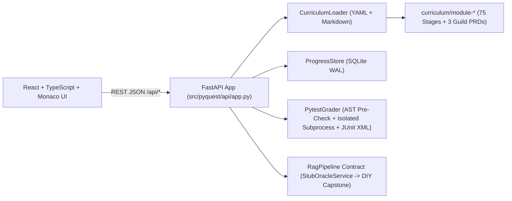

# Python Terminal Quest

A calm Obsidian 16-bit RPG learning workspace for mastering modern **Python 3.13**, **Data Structures**, **OOP**, **Django/DRF**, **Architecture & Typing**, **Asyncio**, **Raw SQL**, **SQLAlchemy 2.0 & Alembic**, **FastAPI**, **Redis Caching/Rate Limiting**, **Distributed Resilience**, and **AI & Production RAG**.

**Complete Curriculum:** 12 modules • 75 interactive lessons (63 core + 12 Boss Fights) • 3 Portfolio Guild PRDs (`CLI Financial Ledger Reconciler`, `High-Concurrency Inventory & Audit Service`, `Mini-Sidekiq Distributed Job Engine + AI Triage & AWS Mapping`).

---

## Architecture Overview



### Engineering Highlights
- **Isolated `pytest` Grader (`src/pyquest/runner/grader.py`):** Pre-validates Python syntax via `ast.parse` for clickable line/column diagnostics in Monaco, blocks forbidden `conftest.py` / `tests/` path overrides, isolates environment variables, enforces POSIX CPU/file-size `rlimit`s + wall-clock timeouts, and parses JUnit XML + `stdout`/`stderr`.
- **SQLite WAL State & Spaced Review (`src/pyquest/persistence/store.py`):** Persists multi-file code drafts, study notes, flagged stages, daily streaks, 5-tier Hero Companion progression, **Cold Clear vs. Assisted (`needsReview`)** status, Portfolio Guild checklists, and full JSON export/import backups (`GET /api/progress/export`, `POST /api/progress/import`).
- **Workspace Productivity (`web/src/`):** Split-pane Obsidian Monaco Editor with reference solution diffing, clickable syntax diagnostics, read-only **`Tests` (`pytest`)** inspector, Battle Log `stdout` rendering, per-lesson persistent Oracle chat history, and Campfire LinkedIn reflection outlines.
- **Hardened Container & Demo Mode:** Multi-stage non-root `Dockerfile` (`USER pyquest`) and optional read-only `PYQUEST_DEMO_MODE=true` guard disabling arbitrary code execution and state imports for safe public previews.
- **Pluggable DIY Socratic RAG Capstone (`src/pyquest/rag/`):** Clean ABCs (`EmbeddingClient`, `VectorStore`, `LlmClient`, `RagPipeline`) intentionally wired to `StubOracleService` so the production hybrid RAG engine can be implemented hands-on after Module 12.

---

## Curriculum Map (12 Modules • 75 Stages)

| Module | Topic Focus | Stages | Boss Fight |
|---|---|---|---|
| **01** | Python Fundamentals (`Decimal`, `match/case`, mutable traps, domain exceptions) | 9 | Fee & Policy Evaluator Engine |
| **02** | Data Structures & Core Algorithms (`deque`, `Counter`, `heapq`, BST) | 8 | Log Stream Sliding-Window & Top-K Tracker |
| **03** | Object-Oriented Programming (`@dataclass`, `@property`, `Protocol`, dunders) | 6 | Extensible Order Book Domain |
| **04** | Advanced Python (Decorators, `yield`/`batched`, context managers, atomic writes) | 7 | Streaming PII Log Redactor |
| **05** | Ecosystem & Web Base (NumPy, Pandas, Matplotlib, Flask, Requests, BS4, Django/DRF) | 8 | Automated Web Report Collector |
| **06** | Architecture, Typing & `pytest` (`src/` layout, PEP 695/Pydantic v2, test doubles) | 5 | Multi-Module Billing Core |
| **07** | Concurrency & `asyncio` (GIL/profiling, pools, `TaskGroup`, `httpx` backpressure) | 5 | Resilient Async Health Aggregator |
| **08** | Raw SQL Engineering (CTEs, `EXPLAIN QUERY PLAN`, keyset cursors, ACID/locks) | 5 | Inventory Reservation Engine |
| **09** | SQLAlchemy 2.0 & Alembic (Unit of Work/DTOs, `selectinload` zero-N+1, migrations) | 5 | Zero-N+1 Order Repository |
| **10** | FastAPI Production Systems (`Depends`, RFC 7807, PyJWT RBAC, `contextvars`, Redis) | 6 | Hardened Admin Gateway API |
| **11** | Distributed Resilience (Idempotency SHA-256, Circuit Breaker, Outbox, DLQ, HMAC) | 6 | Resilient Event Relay Engine |
| **12** | AI Engineering & Production RAG (PII scrubbing, Pydantic repair, hybrid citations, evals) | 5 | Socratic RAG Tutor Pipeline |

### Portfolio Guild Gates (`curriculum/projects.yaml`)
1. **Gate #1 (After Module 5):** *CLI Financial Ledger Reconciler* (`Decimal`, streaming CSV, atomic reports, CI)
2. **Gate #2 (After Module 9):** *High-Concurrency Inventory & Audit Service* (PostgreSQL 16, SQLAlchemy 2.0 zero-N+1, optimistic locking, Alembic)
3. **Gate #3 (After Module 12):** *Mini-Sidekiq Distributed Job Engine + AI Triage* (Outbox, Circuit Breaker, DLQ, RAG triage + evals, AWS RDS/SQS/S3/ECS mapping)

---

## Quick Start (Local Development)

### 1. Backend (Python + `uv`)
```bash
uv sync
uv run pyquest serve --port 8080
```

### 2. Frontend (Vite + React + Monaco)
```bash
cd web
npm install
npm run dev
```

Or build the frontend once and let FastAPI serve the entire app at `http://localhost:8080`:
```bash
cd web && npm run build && cd ..
uv run pyquest serve --port 8080
```

### Read-Only Demo Mode
To preview the UI safely without executing arbitrary learner code or accepting progress imports:
```bash
PYQUEST_DEMO_MODE=true uv run pyquest serve --port 8080
```

---

## DIY Socratic RAG Capstone (`src/pyquest/rag/`)

By default, the in-app **Oracle** (`POST /api/oracle/ask`) runs in **DIY Capstone Stub mode** (`StubOracleService`, `mode="stub"`) so **you** can implement your own grounded hybrid RAG engine after finishing Module 12!

See [`src/pyquest/rag/CAPSTONE_README.md`](src/pyquest/rag/CAPSTONE_README.md) for:
- The pluggable `VectorStore`, `EmbeddingClient`, `LlmClient`, and `RagPipeline` contracts in `src/pyquest/rag/interfaces.py`.
- Zero-solution-leak indexing rules, PII scrubbing, and prompt-injection guardrails.
- `PYQUEST_LLM_*` dual-mode config, automated RAG evals, and blueprint acceptance tests waiting in `tests/test_oracle_rag.py`.

---

## Verification & Docker
```bash
uv run ruff check .
uv run mypy src
uv run pytest
cd web && npx tsc --noEmit && npm run build
```

```bash
docker compose up --build
```
